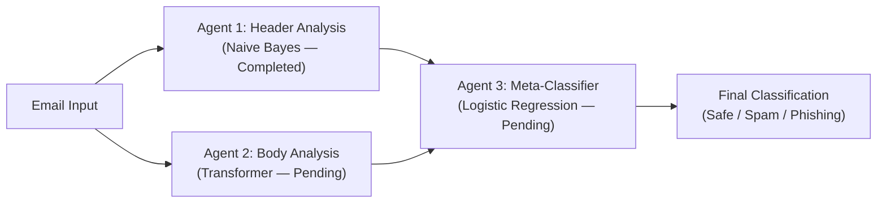

# Anti-Phishing Firewall — Multi-Agent Email Classification System

An academic machine learning project designed to classify incoming emails into **Safe**, **Spam**, and **Phishing** categories using a modular, multi-agent architecture.

> **Current Status:** Shared dataset preparation (`make_dataset.py`) and **Agent 1** (header-based Naive Bayes classifier) are implemented and finalized. **Agent 2**, **Agent 3**, and full system integration are currently **pending**. The complete multi-agent pipeline is not yet operational.

---

## Project Overview

Email threats combine deceptive header metadata (such as spoofed sender domains, timing patterns, and misleading subjects) with persuasive or malicious body text. Relying on a single monolithic classifier can make it harder to separate header-level signals from linguistic content.

This project addresses the problem through a **multi-agent stacking architecture** that divides classification across specialized models:

- **Safe (`0`)**: Legitimate emails that are neither spam nor phishing.
- **Spam (`1`)**: Unsolicited or bulk commercial messages.
- **Phishing (`2`)**: Deceptive or malicious emails intended to trick recipients into revealing sensitive information or taking harmful actions.

By separating header analysis from body analysis and combining their probabilistic outputs via a meta-classifier, each agent can specialize in a distinct modality.

---

## Intended Multi-Agent Architecture

> **Note:** The architecture below describes the **planned** system design. Only **Agent 1** is currently implemented in this repository.

### Agent 1 — Email Header Analysis (`Completed`)
- **Algorithm:** Custom header-only Naive Bayes (`SmoothedCategoricalNB`, v7.0.0)
- **Inputs:** `sender`, `receiver`, `date`, and `subject` headers only (the email body is never used).
- **Outputs:** Class predictions and calibrated probabilities in fixed order `[p_safe, p_spam, p_phishing]`, along with metadata (`nb_score`, `header_completeness`, `insufficient_evidence`).
- **Role:** Extracts 36 header-derived features and produces strictly out-of-fold (OOF) training predictions (`agent1_oof_train.csv`) and validation/test predictions (`agent1_predictions.csv`) intended for Agent 3.

### Agent 2 — Email Body Analysis (`Pending`)
- **Planned Algorithm:** Transformer-based model
- **Inputs:** Email body text
- **Role:** Analyzes linguistic patterns, semantic context, and suspicious expressions in the email body that are not visible in headers.
- **Status:** Not yet implemented or integrated into the repository.

### Agent 3 — Meta-Classifier / Prediction Combination (`Pending`)
- **Planned Algorithm:** Logistic Regression (stacking meta-classifier)
- **Inputs:** Out-of-fold and evaluation predictions/probabilities produced by Agent 1 and Agent 2.
- **Role:** Combines header-level and body-level evidence to produce the final three-class classification.
- **Status:** Not yet implemented or integrated into the repository.

### Architecture Flow



---

## Current Development Status

| Component | Description | Status |
|---|---|---|
| Dataset Pipeline | Shared cleaning, deduplication, and 70/15/15 split (`make_dataset.py`) | Completed |
| Agent 1 | Header-based Naive Bayes classifier (`Agent1_Header_Classification_Final.ipynb`) | Completed |
| Agent 2 | Body-based Transformer classifier | Pending |
| Agent 3 | Logistic Regression stacking classifier | Pending |
| Integration | Complete multi-agent system | Pending |

---

## Repository Structure

```text
anti-phishing-firewall/
├── .gitignore                                 # Excludes data/, models/, and virtual environments
├── Agent1_Header_Classification_Final.ipynb   # Finalized, executed Agent 1 notebook
├── inspect_data.py                            # Exploratory inspection script for raw email and webpage CSVs
├── make_dataset.py                            # Shared dataset builder producing data/processed/emails_clean.csv
├── requirements.txt                           # Python package dependencies for dataset/Agent 1 environment
└── README.md                                  # Project documentation
```

Additional folders and files for **Agent 2**, **Agent 3**, and the **end-to-end integration** will be added as development progresses.

---

## Technologies

### Currently Used (Confirmed in Repository)
- **Language:** Python 3
- **Data Processing & Numerics:** `pandas`, `numpy`, `scipy`, `python-dateutil`, `tzdata`
- **Machine Learning & Serialization:** `scikit-learn` (cross-validation splits and evaluation metrics), `joblib`, `cloudpickle`
- **Development Environment:** Jupyter Notebook

### Planned (Not Yet Implemented)
- **Agent 2:** Transformer-based NLP framework/model for email body classification
- **Agent 3:** `scikit-learn` Logistic Regression stacking meta-classifier

---

## Dataset and Labeling Strategy

The shared dataset (`emails_clean.csv`, 48,939 rows after deduplication: `34,256` train / `7,340` val / `7,343` test) combines four public email corpora: `CEAS_08`, `SpamAssasin`, `Nazario`, and `Nigerian_Fraud`. Because the raw corpora use binary labels (`0` / `1`), Agent 1 constructs its three-class target using a source-aware mapping:

- **Raw `0` (all sources) → `Safe` (`0`)**
- **Raw `1` from `CEAS_08` / `SpamAssasin` → `Spam` (`1`)**
- **Raw `1` from `Nazario` / `Nigerian_Fraud` → `Phishing` (`2`)**

These labels are inherited directly from the original corpora and are not independently verified. In addition, `Nigerian_Fraud` consists largely of advance-fee fraud emails, which represent a broader category of deceptive scams than credential phishing alone.

---

## Installation and Execution

### 1. Environment Setup
Install the dependencies currently listed in `requirements.txt`:

```bash
pip install -r requirements.txt
```

### 2. Dataset Preparation
Raw datasets (`data/`) are excluded from version control via `.gitignore` and must be obtained separately.

`make_dataset.py` expects four source CSV files in `data/emails/`:
- `CEAS_08.csv`
- `Nazario.csv`
- `Nigerian_Fraud.csv`
- `SpamAssasin.csv`

Once placed in `data/emails/`, run:

```bash
python make_dataset.py
```

This generates `data/processed/emails_clean.csv` with a fixed `70% / 15% / 15%` (`train / val / test`) split (`SEED = 42`).

### 3. Running Agent 1
Open `Agent1_Header_Classification_Final.ipynb` in Jupyter (or Kaggle, where the finalized notebook was executed against `emails_clean.csv`). If running locally, update the `DATA_PATH` variable in the notebook to point to `data/processed/emails_clean.csv`.

> Complete end-to-end execution instructions will be added once Agents 2 and 3 are integrated.

---

## Evaluation and Results

> **Scope Note:** All metrics below reflect **Agent 1 (header-only Naive Bayes) only**, verified from the saved outputs of `Agent1_Header_Classification_Final.ipynb`. The complete multi-agent system has **not** yet been integrated or evaluated, and test-split labels remain untouched (`REPORT_ON_TEST = False`). Because each protocol below evaluates a different data partition or grouping constraint, **their metrics are not directly comparable**.

### 1. Headline Estimate: Nested Sender-Disjoint Cross-Validation
The primary internal performance estimate for Agent 1 is obtained via 5-fold outer / 4-fold inner nested cross-validation grouped by canonical sender identity (full 96-candidate grid search, `macro_f1` decision rule):

| Metric | Value |
|---|---|
| Macro F1 | 0.8951 |
| Accuracy | 0.9248 |
| Phishing Precision | 0.8089 |
| Phishing Recall | 0.8140 |
| Phishing AP | 0.8912 |
| Log Loss | 0.2251 |

### 2. Agent-3 Training Predictions: Strictly Cross-Fitted OOF Evaluation
To generate leak-free training features (`agent1_oof_train.csv`) for Agent 3, Agent 1 uses a stricter template-purged, sender-grouped cross-fitting protocol that also hides held-out subject templates from the fitting/selection data:

| Metric | Value |
|---|---|
| Macro F1 | 0.8411 |
| Accuracy | 0.8441 |
| Phishing Precision | 0.8370 |
| Phishing Recall | 0.8327 |
| Phishing AP | 0.9020 |
| Log Loss | 0.3296 |

### 3. Validation Split (Reporting Only)
Once frozen, Agent 1 was evaluated on the held-out validation split (`7,340` rows) for reporting purposes only:

| Metric | Value |
|---|---|
| Macro F1 | 0.9134 |
| Accuracy | 0.9368 |
| Phishing Precision | 0.8887 |
| Phishing Recall | 0.8120 |
| Phishing AP | 0.9140 |
| Log Loss | 0.1939 |

### 4. Known Limitations and Source-Shift Stress Test
- **Corpus/Class Confounding:** Because `Safe` examples come from all four datasets, `Spam` examples come from `CEAS_08` and `SpamAssasin`, and `Phishing` examples originate exclusively from `Nazario` and `Nigerian_Fraud`, header-based features can partially capture corpus-specific metadata habits rather than pure phishing intent.
- **Leave-One-Source-Out (LOSO) Stress Test:** In a pooled LOSO evaluation (selected from the stress-test grid) designed to test source-shift rather than guarantee real-world generalization, header-only performance drops to `Macro F1 = 0.3926` (`Phishing Recall = 0.2801`). This confirms that header features alone do not generalize reliably across unseen email sources and motivates combining Agent 1 with Agent 2's body-text analysis.

---

## Team and Academic Information

*To be completed by the project team:*

- **Institution:** `[University / Department Name]`
- **Course:** `[Course Name / Code]`
- **Supervisor:** `[Supervisor Name]`
- **Team Members:**
  - **Agent 1 (Header Classification):** `[Name]`
  - **Agent 2 (Body Classification):** `[Name]`
  - **Agent 3 (Meta-Classifier & Integration):** `[Name]`
