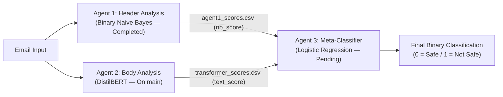

# Anti-Phishing Firewall — Multi-Agent Email Classification System

An academic machine learning project designed to classify incoming emails into **Safe (`0`)** and **Not Safe (`1`)** (combining spam and phishing) using a modular, multi-agent architecture.

> **Current Status:** Shared dataset preparation (`make_dataset.py`), **Agent 1** (`Agent1_Binary.ipynb`, header-based binary Naive Bayes), and **Agent 2** (DistilBERT text classifier on `main`) are implemented. **Agent 3** (Logistic Regression meta-classifier) and full end-to-end system integration are currently **pending**.

---

## Project Overview

Email threats combine deceptive header metadata (such as spoofed sender domains, timing patterns, and misleading subjects) with persuasive or malicious body text. Relying on a single monolithic classifier can make it harder to separate header-level signals from linguistic content.

This project addresses the problem through a **binary multi-agent stacking architecture**:

- **Safe (`0`)**: Legitimate emails that are neither spam nor phishing.
- **Not Safe (`1`)**: Unwanted, deceptive, or malicious emails (spam and phishing combined).

By separating header analysis from body analysis and combining their probabilistic outputs via a meta-classifier, each agent specializes in a distinct modality.

---

## Multi-Agent Architecture

### Agent 1 — Email Header Analysis (`Completed`)
- **Algorithm:** Genuinely two-class ($K=2$) regularized Naive Bayes (`SmoothedCategoricalNB` + `SubjectTokenNB`, `v8.0.0-binary`)
- **Inputs:** `sender`, `receiver`, `date`, and `subject` headers only (the email body is never used).
- **Training & Calibration:** Trained exclusively on `train` (`34,256` rows) with `val`/`test` labels untouched. Applies log-odds temperature scaling (`T = 1.572`) and a single documented log-odds threshold (`0.100`, prob `0.525`).
- **Outputs:** Exports `agent1_scores.csv` (`email_id, split, nb_score` for `val` and `test`) and `agent1_scores_detailed.csv` (`p_safe`, `nb_score`, `nb_logit`, `pred_class`, `header_completeness`, `insufficient_evidence`), plus `agent1_binary_model.joblib` and `agent1_header.py` for standalone inference (`score_email(...) -> float`).

### Agent 2 — Email Body Analysis (`Implemented on main`)
- **Algorithm:** Fine-tuned DistilBERT Transformer (`text_agent.py`, `notebooks/train_transformer.ipynb` on `main`).
- **Inputs:** Email subject and body text.
- **Outputs:** Exports `transformer_scores.csv` (`email_id, split, text_score` for `val` and `test` rows, where `text_score = P(Not Safe)`).

### Agent 3 — Meta-Classifier / Prediction Combination (`Pending`)
- **Planned Algorithm:** Logistic Regression stacking meta-classifier.
- **Inputs:** Merges `agent1_scores.csv` and `transformer_scores.csv` on `email_id` and `split`, **fits on `val` (`7,340` rows)**, and **evaluates once on `test` (`7,343` rows)** against the raw binary `label`.
- **Status:** Not yet implemented or integrated into the repository.

### Architecture Flow



---

## Current Development Status

| Component | Description | Status |
|---|---|---|
| Dataset Pipeline | Shared cleaning, deduplication, and 70/15/15 split (`make_dataset.py`) | Completed |
| Agent 1 | Header-based binary Naive Bayes classifier (`Agent1_Binary.ipynb`) | Completed |
| Agent 2 | Body-based DistilBERT classifier (`text_agent.py` on `main`) | Completed (on `main`) |
| Agent 3 | Logistic Regression stacking classifier (fits on `val`, evaluates on `test`) | Pending |
| Integration | Complete multi-agent system | Pending |

---

## Repository Structure

```text
anti-phishing-firewall/
├── .gitignore                  # Excludes data/, models/, and virtual environments
├── Agent1_Binary.ipynb         # Finalized, executed binary Agent 1 notebook (v8.0.0-binary)
├── inspect_data.py             # Exploratory inspection script for raw email and webpage CSVs
├── make_dataset.py             # Shared dataset builder producing data/processed/emails_clean.csv
├── requirements.txt            # Python package dependencies
└── README.md                   # Project documentation
```

*(Agent 2's `text_agent.py`, `text_baseline.py`, and `notebooks/train_transformer.ipynb` reside on `main`; Agent 3 and end-to-end integration files will be added as development progresses.)*

---

## Technologies

### Currently Used (Confirmed in Repository)
- **Language:** Python 3
- **Data Processing & Numerics:** `pandas`, `numpy`, `scipy`, `python-dateutil`, `tzdata`
- **Machine Learning & Serialization:** `scikit-learn`, `joblib`, `cloudpickle`
- **Development Environment:** Jupyter Notebook

### Planned for Agent 3 (Not Yet Implemented)
- **Agent 3:** `scikit-learn` Logistic Regression stacking meta-classifier

---

## Dataset and Binary Target Definition

The shared dataset (`emails_clean.csv`, 48,939 rows after deduplication: `34,256` train / `7,340` val / `7,343` test, `SEED = 42`) combines four public email corpora: `CEAS_08`, `SpamAssasin`, `Nazario`, and `Nigerian_Fraud`.

The project uses the dataset's raw binary `label` directly:
- **`0` = `Safe`**
- **`1` = `Not Safe`** (spam from `CEAS_08` / `SpamAssasin` and phishing/advance-fee fraud from `Nazario` / `Nigerian_Fraud` combined)

`source` is never used as a predictive feature; it is retained strictly for diagnostic checks and Leave-One-Source-Out (LOSO) stress testing. These labels are inherited directly from the original corpora and are not independently verified.

---

## Installation and Execution

### 1. Environment Setup
```bash
pip install -r requirements.txt
```

### 2. Dataset Preparation
Raw datasets (`data/`) are excluded from version control via `.gitignore` and must be obtained separately. Place `CEAS_08.csv`, `Nazario.csv`, `Nigerian_Fraud.csv`, and `SpamAssasin.csv` in `data/emails/` and run:

```bash
python make_dataset.py
```

This generates `data/processed/emails_clean.csv` with a fixed `70% / 15% / 15%` (`train / val / test`) split.

### 3. Running Agent 1
Open `Agent1_Binary.ipynb` in Jupyter (or Kaggle). If running locally, it automatically searches `data/processed/emails_clean.csv`. Executing the notebook generates `agent1_binary_outputs/agent1_scores.csv`, `agent1_scores_detailed.csv`, `agent1_binary_model.joblib`, `agent1_header.py`, and `agent1_binary_meta.json` independently of Agent 2.

---

## Evaluation and Results (Agent 1 Only)

> **Scope Note:** All metrics below reflect **Agent 1 (header-only binary Naive Bayes) only**, verified from the executed outputs of `Agent1_Binary.ipynb`. The complete multi-agent system has **not** yet been integrated or evaluated, and `test` labels remain untouched (`REPORT_ON_TEST = False`). Because each protocol enforces different grouping constraints, **their metrics are not directly comparable**.

### 1. Headline Internal Estimate: Nested Sender-Disjoint Cross-Validation
5-fold outer / 4-fold inner nested CV grouped by canonical sender identity (full 96-candidate grid; candidate selection via threshold-independent metrics + F1 at fixed `0.5`, followed by post-selection inner-OOF temperature scaling and `f1_opt` threshold tuning):

| Metric | Value |
|---|---|
| Accuracy | 0.9404 |
| Precision (Not Safe) | 0.9413 |
| Recall (Not Safe) | 0.9538 |
| F1 (Not Safe) | 0.9475 |
| Macro F1 | 0.9393 |
| ROC-AUC | 0.9867 |
| Average Precision (AP) | 0.9896 |
| FPR | 0.0768 |
| Log Loss | 0.1460 |
| ECE | 0.0087 |

### 2. Template-Disjoint and Template-Purged Stress Tests
| Protocol | Accuracy | F1 (Not Safe) | Macro F1 | ROC-AUC | AP | Log Loss |
|---|---|---|---|---|---|---|
| Nested Template-Disjoint | 0.9368 | 0.9451 | 0.9353 | 0.9813 | 0.9838 | 0.1704 |
| Nested Sender-Disjoint + Template-Purged | 0.8708 | 0.8779 | 0.8704 | 0.9682 | 0.9735 | 0.2409 |

### 3. Validation Split (Reporting Only)
Evaluated once on the frozen binary model (`7,340` rows; never used for fitting, selection, calibration, or threshold tuning):

| Metric | Value |
|---|---|
| Accuracy | 0.9512 |
| Precision (Not Safe) | 0.9558 |
| Recall (Not Safe) | 0.9577 |
| F1 (Not Safe) | 0.9568 |
| Macro F1 | 0.9504 |
| ROC-AUC | 0.9901 |
| Average Precision (AP) | 0.9921 |
| FPR | 0.0571 |
| Log Loss | 0.1250 |
| ECE | 0.0088 |

### 4. Known Limitations and Leave-One-Source-Out (LOSO) Stress Test
- **Corpus/Class Confounding:** `Safe` examples come from `CEAS_08` and `SpamAssasin`, `Spam` comes from `CEAS_08` and `SpamAssasin`, and `Phishing` originates exclusively from `Nazario` and `Nigerian_Fraud`. Header features can partially reflect corpus-specific metadata habits.
- **LOSO Source-Shift Stress Test (selected from stress grid):**
  - `CEAS_08` (both classes): Accuracy `0.6869` (`argmax`) / `0.6335` (`f1_opt`), ROC-AUC `0.8136`, AP `0.7718` (vs. Agent 2 reference `0.8226`).
  - `SpamAssasin` (both classes): Accuracy `0.7431` (`argmax`) / `0.7474` (`f1_opt`), ROC-AUC `0.8123`, AP `0.6598` (vs. Agent 2 reference `0.8753`).
  - `Nazario` (class `1` only): Recall `0.5198` (`argmax`) / `0.4642` (`f1_opt`).
  - `Nigerian_Fraud` (class `1` only): Recall `0.8244` (`argmax`) / `0.8098` (`f1_opt`).
- **Header-Only Ceiling:** Compromised legitimate accounts can send malicious emails with clean headers, motivating Agent 2's body-text analysis and Agent 3's stacking combination.

---

## Team and Academic Information

*To be completed by the project team:*

- **Institution:** `[University / Department Name]`
- **Course:** `[Course Name / Code]`
- **Supervisor:** `[Supervisor Name]`
- **Team Members:**
  - **Agent 1 (Header Classification):** `[Name]`
  - **Agent 2 (Body Classification):** `[Name]`
  - **Agent 3 (Meta-Classifier & Integration):** `[Name]`
